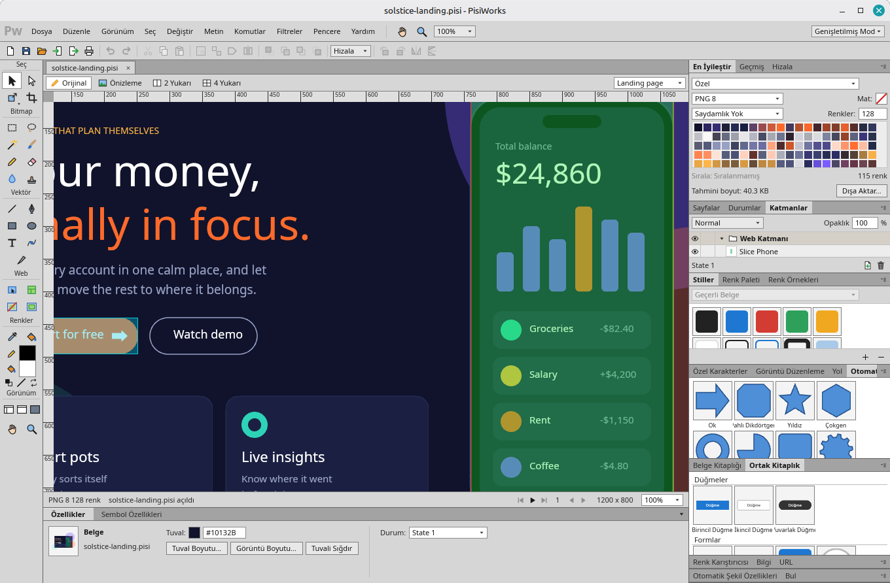
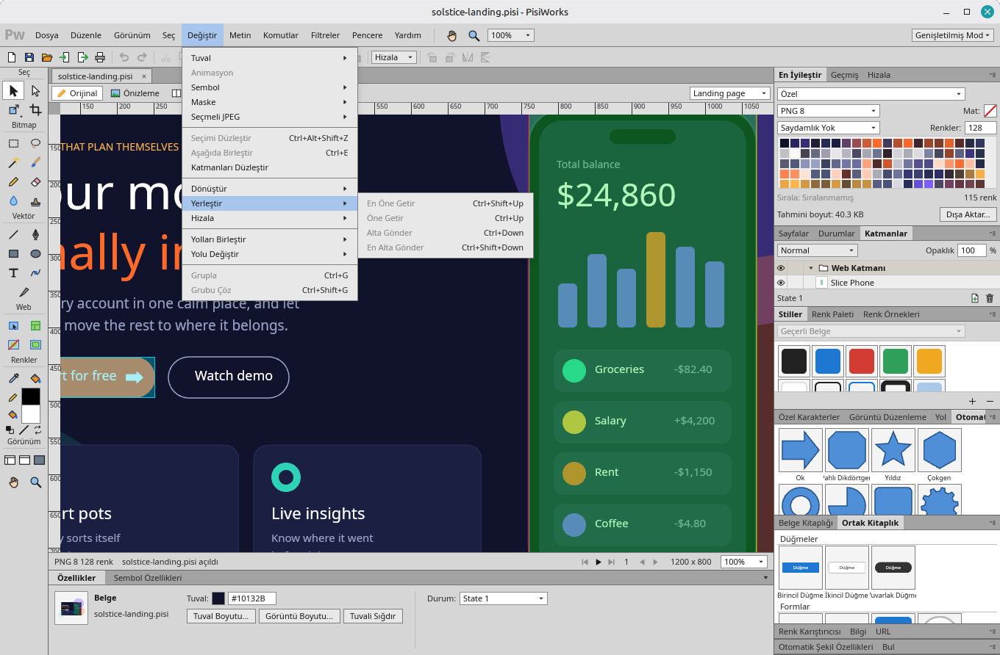

<h1 align="center">PisiWorks</h1>

<p align="center">
  <strong>An open-source Adobe Fireworks look-alike for Pardus, with a Turkish interface.</strong><br>
  For the teachers who still teach Fireworks, and their students.
</p>

<p align="center">
  <a href="LICENSE"></a>
  
  
  
</p>

<p align="center">
  <a href="#get-started">Get started</a> ·
  <a href="#features">Features</a> ·
  <a href="docs/guide.md">User guide</a> ·
  <a href="README.md">Türkçe</a>
</p>

<p align="center">
  
</p>

> **PisiWorks is developed by Murat SAPMAZ** as an independent free-software project for schools in Turkey and for Pardus users. Its foundation is [Emberframe](https://github.com/gregstein/emberframe) by [Med Amine Belbachir](https://medamineweb.com/): without it this project could not have existed so soon, and we thank him. About a third of today's code comes from Emberframe and two thirds were written for PisiWorks; [what was done is listed below](#what-was-done-in-pisiworks).

## Why PisiWorks

Adobe stopped developing Fireworks in 2013, but the program that mixed vector shapes, bitmap editing, states and web export in one window is still taught in schools. PisiWorks aims to offer the same way of working on the [Pardus](https://www.pardus.org.tr/) operating system, in Turkish, as free software.

It is deliberately a look-alike: the same docked layout, tool groups, panels and light gray interface, and in Turkish the menus and command names are those of the Turkish edition of Fireworks. It is published under its own name, every icon is newly drawn, and it contains no Adobe code or artwork.

## Features

| Area | What you get |
|---|---|
| **Tools** | Pointer, Select Behind, Subselection, Scale, Skew, Distort, Crop, Marquee, Oval Marquee, Lasso, Polygon Lasso, Magic Wand, Brush, Pencil, Eraser, Blur, Sharpen, Dodge, Burn, Smudge, Rubber Stamp, Replace Color, Red Eye Removal, Eyedropper, Paint Bucket, Gradient, Line, Pen, Vector Path, Rectangle, Ellipse, Polygon, Text, Freeform, Knife, Hotspot, Slice, Hand, Zoom |
| **Panels** | Optimize, History, Align, Pages, States, Layers, Styles, Color Palette, Swatches, Path, Auto Shapes, Document Library, Common Library, Color Mixer, Info, URL, Find, Special Characters, Image Editing, Properties, Symbol Properties |
| **Vector** | Bezier curves and point editing, Auto Shapes, Union, Intersect, Punch, Crop, Join, Split, Simplify, Expand Stroke, Inset and Outset |
| **Transforming** | Scale, Skew, Distort, a movable center point, Numeric Transform, rotating and flipping |
| **Appearance** | Gradient fills of 12 kinds and pattern fills, 45 blend modes, masks, 29 live filters including Levels and Curves, Photoshop Live Effects with ten effects, styles |
| **Bitmap** | Paint, erase, clone, flood fill, pixel selections, Feather, Select Similar and Inverse, the marquee commands, Flatten Selection and Flatten Layers |
| **Text** | Installed fonts, bold, italic, underline, alignment, Convert to Paths |
| **Layout** | Rulers, grid, guides, smart guides, slice guides, groups with Superselect and Subselect |
| **Screens and animation** | Pages, layers, shared layers, states, onion skinning, symbols and a library |
| **Export** | PNG 8, PNG 24, PNG 32, JPEG with selective quality and smoothing, GIF and animated GIF, with Preview, 2-Up and 4-Up comparison, slices and HTML image maps |
| **Documents** | Native `.pisi` files (`.ember` files from Emberframe open too), opening and importing common image formats, Canvas Size, Image Size, Fit Canvas and Trim Canvas |
| **Printing** | Page Setup, printing to an installed printer or saving as PDF |
| **Language** | Turkish and English, changed from Edit > Language |

<p align="center">
  
</p>

## Get started

Building and packaging are done on Linux Mint 22.3. The `.deb` package **has been installed and run on Pardus 25**, the system it is meant for (November 2026).

### Installing a package

There is no ready-made `.deb` in the repository; one command builds it from source (the build requirements below must be installed):

```bash
packaging/build-deb.sh
```

The package is written to `target/deb/` and installed with:

```bash
sudo apt install ./target/deb/pisiworks_0.1.0_amd64.deb
```

After that PisiWorks is in the Graphics section of the application menu, and `.pisi` files open in it on a double-click. The maintainer written into the package is taken from the `DEB_MAINTAINER` environment variable, or failing that from git's `user.name` and `user.email`.

### Building from source

You need Rust 1.91 or later (from [rustup](https://rustup.rs/)) and these packages:

```bash
sudo apt install build-essential pkg-config libxcb1-dev libxkbcommon-dev libxkbcommon-x11-dev
```

The program draws with Vulkan. If the graphics driver has no Vulkan support, the software driver will do:

```bash
sudo apt install mesa-vulkan-drivers
```

To build and run:

```bash
git clone https://github.com/MuratSAPMAZ/PisiWorks.git
```

```bash
cd PisiWorks
```

```bash
git checkout pisiworks
```

```bash
cargo run --release
```

The first build takes a while. Then open [`examples/solstice-landing.pisi`](examples/solstice-landing.pisi) with Ctrl+O to explore the design in the screenshots. The [user guide](docs/guide.md) explains the tools and panels.

To run the tests:

```bash
cargo test
```

Printing needs the system's print service (CUPS).

## What was done in PisiWorks

PisiWorks was forked from Emberframe 0.1. Emberframe gave us a sound start: the window layout, the tool palette and panels, the icons, the object model with layers, pages, states and symbols, the basic drawing and bitmap tools, path operations, Auto Shapes and export all come from it, and about 92% of that code is still in place.

On top of it we added, piece by piece, everything a teacher who still teaches Fireworks would need. Emberframe's menus had 42 commands greyed out; PisiWorks has none.

| | Emberframe 0.1 | PisiWorks |
|---|---|---|
| Source code | 12,286 lines in 16 files | 32,733 lines in 29 files |
| Automated tests | 141 | 300 |
| Menu commands that do nothing (greyed out) | 42 | 0 |
| Interface language | English | Turkish and English |

Written for PisiWorks:

| Area | Added in PisiWorks |
|---|---|
| **Linux and Pardus** | Builds and runs on Linux, a fix for the crash when typing Turkish letters through an input method, a font chosen from those installed, a plain message when the graphics driver is missing, a `.deb` package, an application icon and the `.pisi` file type |
| **Turkish** | The whole interface in Turkish, with the terms of the Turkish edition of Fireworks, a language menu, tests that fail when a text has no translation, and a user guide in Turkish |
| **Tools** | 21 new tools: Select Behind, Oval Marquee, Polygon Lasso, Sharpen, Dodge, Burn, Smudge, Replace Color, Red Eye Removal, Gradient, Vector Path, Redraw Path, Polygon, Freeform, Reshape Area, Path Scrubber, 9-Slice Scaling, and polygon and circle Hotspot and Slice tools; tool groups and tool options |
| **Vectors** | Bezier curves, full point and handle editing with the Pen and Subselection tools, and curve fitting after path operations |
| **Transforming** | Scale, Skew and Distort with a movable center point, and Numeric Transform |
| **Fills and appearance** | Gradient fills of 12 kinds, pattern and web-dither fills, gradient handles on the canvas, edge and texture; 45 blend modes; masks with all their commands |
| **Filters** | 29 live filters including Levels and Curves; Photoshop Live Effects with ten effects, all their settings and a gradient editor |
| **Bitmaps** | Moving selected pixels, Feather, Select Similar and Inverse, the marquee commands, Flatten Selection, Merge Down and Flatten Layers |
| **Text** | Fonts, bold, italic, underline, five alignments, vertical and right-to-left text, text on a path, and spell checking with the system's dictionaries |
| **Layout** | Guides, smart guides, slice guides, an adjustable grid with Snap to Grid, and Subselect and Superselect for groups |
| **Symbols and animation** | Editing a symbol in place, New Symbol, button symbols with four states (answering the mouse in Preview and in the exported HTML), Animate Selection and an animation path that can be dragged |
| **Files** | Reading the layers of Fireworks PNG files, New from Template and Save as Template, Batch Process, Image Preview, and selective JPEG quality with a JPEG encoder of its own |
| **Commands** | Saving the steps of the History panel as commands and playing them again, command files, and ready-made commands (Add Arrowheads, Add Picture Frame, Add Shadow, Auto Vector Mask, Twist and Fade, Grayscale, Sepia, Distribute to Layers and others) |
| **Printing** | Page Setup, page ranges, tiling large pages over sheets, sending to a printer or saving a PDF |
| **Settings** | Preferences, and keyboard shortcuts that can be reassigned for every menu command |
| **Animated GIF** | Opening an animated GIF as states, the number of times it plays, Tween Instances for the frames in between, and Make a GIF in the right-hand menu, which turns picture files into a GIF in one step |
| **Examples** | An Examples menu at the right end of the menu bar, apart from the Fireworks menus: seven ready documents to open, look into and change (web banner, navigation buttons, animation, school poster, gradients, filters, web page mockup) |

The figures are from November 2026 and will drift as work goes on.

## PisiSahne: the animation program (first stage)

A second program is built from the same repository: **PisiSahne**, an animation program in the manner of Adobe Flash, which the same schools still teach. It uses all of PisiWorks' drawing tools, filters and symbols, and adds a timeline under the stage.

```bash
cargo run --release --bin pisisahne
```

Working at this stage:

- The timeline: layers, frames, keyframes and blank keyframes (F5, F6, F7; Shift+F5 and Shift+F6 to remove).
- Motion tweens: between two keyframes, place, size, turn and opacity change step by step. Changing an object on a frame inside a tween makes a keyframe of that frame, as in Flash.
- Shape tweens: the shapes of a keyframe change, outline and color, into those of the next keyframe.
- Shape hints (Ctrl+Shift+H): lettered marks, dragged on the stage, that say which point of a shape is to become which.
- Guide layers: the tweened objects of the layers tied to one travel along its path, turning to face the way it runs if asked. Mask layers: the layers tied to one show only where the mask has something drawn. Several layers can be tied to one guide or mask. Guides are not drawn when publishing; masks are applied in Preview, when publishing and, as in Flash, on the stage once their layers are locked.
- Easing (from −100 to 100) and, for a motion tween, a number of turns.
- Movie clip symbols: symbols with a timeline of their own. A double-click on a copy opens the clip's own page; in the published film it plays its own frames even while the scene stands still.
- Button symbols and ready-made actions: Stop, Play, Go to Frame and Play, Go to Frame and Stop, Go to Scene, Go to Address. An action is given to a keyframe or to a button; no code is written.
- Scenes: every page in the Scenes panel is a scene, and the film plays them one after another.
- Sound: an MP3, OGG or WAV file is imported and started on a keyframe.
- Test Movie (Ctrl+Enter) publishes the film and opens it in the browser.
- Playing, stepping frame by frame, the frame rate and onion skinning.
- Six ready animations in the Examples menu: a bouncing ball, changing shapes, along a path, a spotlight, turning gears, and two scenes with buttons.
- Exchange with PisiWorks: **PisiSahne > Open in PisiSahne** in PisiWorks opens the document in the animation program, and **PisiWorks > Open Frame in PisiWorks** in PisiSahne opens the frame on show in the design program, each as a copy. **File > Import** in either program brings in a document of the other, with its objects and symbols.
- `.sahne` documents. PisiWorks opens `.sahne` files and PisiSahne opens `.pisi` files; artwork passes between the two as it is.
- **Control > Publish as HTML5** writes the animation as a single HTML file that plays in a browser. Each frame is in the page as a picture, drawn as the program draws it.

The window is laid out as Flash's classic workspace is: the timeline over the stage, the tools on the left, Properties at the bottom; layers are in the timeline. Enter plays. The `.deb` package installs both programs.

Known differences from Flash: there is no ActionScript; ready-made actions take its place. `.fla` and `.swf` files are neither opened nor written. In the published page every frame, and every frame of a clip, is a picture. Clips inside clips play by their own frames too; only a button placed inside a clip cannot be clicked in the published film (buttons on the stage can). While playing inside the program (Enter), frame actions are not run and clips show their first frame, as in Flash; the whole film is seen with Test Movie.

The Turkish terms are our own rendering, for want of a Turkish Flash installation to take them from, and may differ from the words in teachers' notes. They are all in one translation table and will be corrected if the right ones are reported.

## Not in this version

- Fireworks' JavaScript (JSF) scripts and extensions: Run Script plays only PisiWorks' own command files (one menu command on each line). The dialogs of the ready-made commands are not copies of Fireworks' own: Add Arrowheads offers five heads and Auto Vector Mask seven masks. Adobe's templates are not there either; New from Template lists our own and the ones you save.
- Paths, text and groups in Fireworks PNG files. Layers, states, bitmap objects and the Drop Shadow effect are read; a file that has a path, text or group opens as its flat picture. Adobe never published the format, so the reader was worked out from a few files written by Fireworks 8 and has not been tried on files from other versions. Fireworks PNG is not written.
- Photoshop's own pattern and gradient libraries in Photoshop Live Effects.
- A ready-made package to download. For now the `.deb` is built from source.

The program has not been tested side by side with Adobe Fireworks itself; the pixel results of filters and blend modes may differ from those of Fireworks. The one exception: a Drop Shadow (softness 1) in a file written by Fireworks 8 was compared with our drawing of it, and 287 of 289 pixels came out the same. Reports of differences and bugs are welcome.

## Who we are, license and thanks

**PisiWorks** is developed and maintained by **Murat SAPMAZ**: [github.com/MuratSAPMAZ/PisiWorks](https://github.com/MuratSAPMAZ/PisiWorks). Bug reports, suggestions and contributions are welcome there. It is an independent project, not affiliated with TÜBİTAK ULAKBİM, which develops Pardus, nor with Adobe.

**Thanks.** PisiWorks stands on Emberframe, which **Med Amine Belbachir** wrote and opened to everyone under the MIT license. We thank him for his work and his generosity:

- Website: [medamineweb.com](https://medamineweb.com/)
- Emberframe: [github.com/gregstein/emberframe](https://github.com/gregstein/emberframe) · [project page](https://medamineweb.com/en/emberframe/)
- GitHub: [@gregstein](https://github.com/gregstein)

**License.** PisiWorks is released under the same [MIT license](LICENSE) as Emberframe. Where the code comes from, the licenses of the libraries compiled into it ([list](docs/THIRD-PARTY.md)) and how it stands toward Adobe are set out in the [license and copyright statement](docs/lisans-ve-telif.md) (in Turkish). The license file keeps the copyright notice of Emberframe's author and adds, beside it, the notice for what was written for PisiWorks.

Adobe and Fireworks are trademarks of Adobe Inc. PisiWorks contains no code or artwork of Adobe's.
