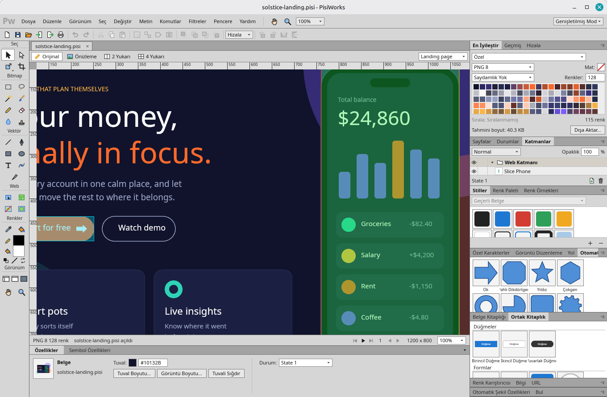
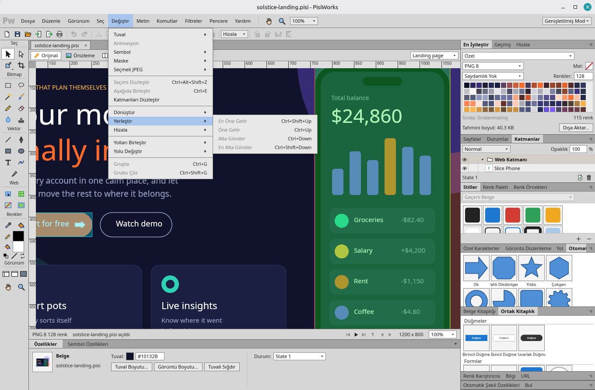

<h1 align="center">PisiWorks</h1>

<p align="center">
  <strong>Pardus için, Türkçe arayüzlü, açık kaynak bir Adobe Fireworks benzeri.</strong><br>
  Fireworks'ü hâlâ derslerinde anlatan öğretmenler ve öğrencileri için.
</p>

<p align="center">
  <a href="LICENSE"></a>
  
  
  
</p>

<p align="center">
  <a href="#kurulum">Kurulum</a> ·
  <a href="#özellikler">Özellikler</a> ·
  <a href="docs/guide.tr.md">Kullanım kılavuzu</a> ·
  <a href="README.en.md">English</a>
</p>

<p align="center">
  
</p>

> PisiWorks, [Med Amine Belbachir](https://medamineweb.com/)'in yazdığı [Emberframe](https://github.com/gregstein/emberframe) projesinin bir çatalıdır. Temeli Emberframe'in kodudur; üzerine neler eklendiği [aşağıda](#emberframeden-farklar) yazıyor.

## Neden PisiWorks

Adobe, Fireworks'ü geliştirmeyi 2013'te bıraktı; ama vektör çizimi, bitmap düzenlemeyi, durumları ve web için dışa aktarmayı tek pencerede toplayan bu program okullarda hâlâ anlatılıyor. PisiWorks, aynı çalışma biçimini Pardus üzerinde, Türkçe olarak ve özgür yazılım olarak sunmayı amaçlar.

Bilerek bir benzeridir: aynı yerleşik düzen, araç grupları, paneller ve açık gri arayüz; menüler ve komut adları Türkçe Fireworks'tekilerle aynıdır. Kendi adıyla yayımlanır, bütün simgeleri yeniden çizilmiştir ve Adobe'ye ait hiçbir kod ya da görsel içermez.

## Özellikler

| Alan | Neler var |
|---|---|
| **Araçlar** | İşaretçi, Arkasındakini Seç, Alt Seçim, Ölçek, Eğriltme, Deformasyon, Kırpma, Seçim Çerçevesi, Oval Seçim Çerçevesi, Kement, Çokgen Kement, Sihirli Değnek, Fırça, Kurşun Kalem, Silgi, Bulanıklaştırma, Keskinleştir, Soldurma, Yakma, Leke, Lastik Damgası, Renk Değiştir, Kırmızı Göz Kaldırma, Damlalık, Boya Kovası, Degrade, Çizgi, Kalem, Vektör Yol, Dikdörtgen, Elips, Çokgen, Metin, Serbest Biçim, Bıçak, Sıcak Nokta, Dilim, El, Yakınlaştırma |
| **Paneller** | En İyileştir, Geçmiş, Hizala, Sayfalar, Durumlar, Katmanlar, Stiller, Renk Paleti, Renk Örnekleri, Yol, Otomatik Şekiller, Belge Kitaplığı, Ortak Kitaplık, Renk Karıştırıcısı, Bilgi, URL, Bul, Özel Karakterler, Görüntü Düzenleme, Özellikler, Sembol Özellikleri |
| **Vektör** | Bezier eğrileri ve nokta düzenleme, Otomatik Şekiller, yolları birleştirme (Birleştir, Böl, Topla, Kesiştir, Zımbala, Kırp), Basitleştir, Konturu Genişlet, Yolu Daralt ve Yolu Genişlet |
| **Dönüştürme** | Ölçek, Eğriltme, Deformasyon, taşınabilir merkez noktası, Sayısal Dönüştürme, döndürme ve çevirme |
| **Görünüm** | Degrade (12 tür) ve desen dolguları, 45 karışım modu, maskeler, 29 canlı filtre (Düzeyler ve Eğriler dahil), on efektli Photoshop Canlı Efektleri, stiller |
| **Bitmap** | Boyama, silme, klonlama, doldurma, piksel seçimleri, Geçiş Yumuşatma, Benzerini ve Tersini Seç, seçim çerçevesi komutları, Seçimi ve Katmanları Düzleştir |
| **Metin** | Kurulu fontlar, kalın, italik, altı çizili, hizalama, Yollara Dönüştür |
| **Düzen** | Cetveller, ızgara, kılavuzlar, akıllı kılavuzlar, dilim kılavuzları, gruplar ile Üst Seç ve Alt Seç |
| **Ekranlar ve animasyon** | Sayfalar, katmanlar, paylaşılan katmanlar, durumlar, soğan zarı, semboller ve kitaplık |
| **Dışa aktarma** | PNG 8, PNG 24, PNG 32, JPEG (seçmeli kalite ve yumuşatma ile), GIF ve animasyonlu GIF; Önizleme, 2 Yukarı ve 4 Yukarı karşılaştırma; dilimler ve HTML görüntü eşlemleri |
| **Belgeler** | Kendi `.pisi` dosyaları (Emberframe'in `.ember` dosyaları da açılır), yaygın görüntü biçimlerini açma ve içe aktarma, Tuval Boyutu, Görüntü Boyutu, Tuvali Sığdır ve Tuvali Kes |
| **Yazdırma** | Sayfa Yapısı, kurulu yazıcıya gönderme veya PDF olarak kaydetme |
| **Dil** | Türkçe ve İngilizce; Düzenle > Dil menüsünden değiştirilir |

<p align="center">
  
</p>

## Kurulum

Derleme, paketleme ve çalıştırma Linux Mint 22.3 üzerinde doğrulandı. Hedef Pardus 25'tir, ancak **Pardus 25 üzerinde henüz denenmedi**.

### Paketle kurma

Depoda hazır `.deb` dosyası bulunmaz; paket kaynaktan tek komutla üretilir (aşağıdaki derleme gereksinimleri kurulu olmalıdır):

```bash
packaging/build-deb.sh
```

Paket `target/deb/` klasörüne yazılır ve şöyle kurulur:

```bash
sudo apt install ./target/deb/pisiworks_0.1.0_amd64.deb
```

Kurulumdan sonra PisiWorks uygulama menüsünün Grafik bölümünde görünür ve `.pisi` dosyaları çift tıklayınca PisiWorks ile açılır. Pakete yazılan bakımcı adı `DEB_MAINTAINER` ortam değişkeninden, o yoksa git'in `user.name` ve `user.email` ayarlarından alınır.

### Kaynaktan derleme

Gerekenler: Rust 1.91 veya üzeri ([rustup](https://rustup.rs/) ile kurulabilir) ve şu paketler:

```bash
sudo apt install build-essential pkg-config libxcb1-dev libxkbcommon-dev libxkbcommon-x11-dev
```

Program ekrana Vulkan ile çizer. Ekran kartı sürücüsü Vulkan desteklemiyorsa yazılımsal sürücü de iş görür:

```bash
sudo apt install mesa-vulkan-drivers
```

Derleyip çalıştırmak için:

```bash
git clone https://github.com/MuratSAPMAZ/PisiWorks.git
```

```bash
cd PisiWorks
```

```bash
git checkout pisiworks
```

```bash
cargo run --release
```

İlk derleme uzun sürer. Program açılınca Ctrl+O ile [`examples/solstice-landing.pisi`](examples/solstice-landing.pisi) dosyasını açıp ekran görüntülerindeki tasarımı inceleyebilirsiniz. Araçlar ve paneller [kullanım kılavuzunda](docs/guide.tr.md) anlatılıyor.

Testleri çalıştırmak için:

```bash
cargo test
```

Yazdırma için sistemin yazdırma hizmeti (CUPS) gerekir.

## Emberframe'den farklar

PisiWorks, Emberframe 0.1'den çatallandı ve onu temel olarak korur: pencere düzeni, menüler, araç paleti ve paneller, simgeler, katmanları, sayfaları, durumları ve sembolleriyle nesne modeli, temel çizim ve bitmap araçları, yol işlemleri, Otomatik Şekiller ve dışa aktarma Emberframe'den gelir. Emberframe'in satırlarının yaklaşık %94'ü yerinde durur.

| | Emberframe 0.1 | PisiWorks |
|---|---|---|
| Kaynak kod | 16 dosyada 12.286 satır | 25 dosyada 25.179 satır |
| Test | 141 | 271 |

Üzerine eklenenler:

| Alan | PisiWorks'te eklenen |
|---|---|
| **Linux ve Pardus** | Linux'ta derlenip çalışma, giriş yöntemiyle Türkçe harf yazınca oluşan çökmenin düzeltilmesi, kurulu fontlardan seçim, grafik sürücüsü eksikse anlaşılır bir uyarı |
| **Türkçe** | Türkçe Fireworks'ün terimleriyle bütün arayüz, dil menüsü, çevirisi eksik metni yakalayan testler |
| **Vektör** | Bezier eğrileri, Kalem ve Alt Seçim araçlarıyla nokta ve tutamaç düzenleme, yol işlemlerinden sonra eğri uydurma |
| **Dönüştürme** | Taşınabilir merkez noktasıyla Ölçek, Eğriltme ve Deformasyon; Sayısal Dönüştürme |
| **Görünüm** | 45 karışım modu, bütün komutlarıyla maskeler, Düzeyler ve Eğriler dahil 29 canlı filtre, on efekti ve degrade düzenleyicisiyle Photoshop Canlı Efektleri |
| **Bitmap** | Seçili pikselleri taşıma, Geçiş Yumuşatma, Benzerini ve Tersini Seç, seçim çerçevesi komutları, Seçimi Düzleştir, Aşağıda Birleştir, Katmanları Düzleştir |
| **Metin** | Font, kalın, italik, altı çizili ve hizalama |
| **Düzen** | Kılavuzlar, akıllı kılavuzlar, dilim kılavuzları, gruplar için Üst Seç ve Alt Seç |
| **Dışa aktarma** | Kendi JPEG kodlayıcısıyla seçmeli JPEG kalitesi ve yumuşatma |
| **Diğer** | Yazdırma ve Sayfa Yapısı, kitaplık panellerinden tuvale sürükleme, `.pisi` dosya uzantısı, daha önce gri olan otuzdan fazla menü komutu |

Rakamlar Kasım 2026'ya aittir ve çalışma sürdükçe değişecektir.

## Bu sürümde olmayanlar

- Menülerde gri görünen komutlar: Şablondan Yeni, Görüntü Önizleme, Toplu İşlem, Yeni Düğme, Yeni Sembol (boş sembol düzenleyicisi), Tercihler, Klavye Kısayolları, Animasyon, metinde Yaslanmış ve Uzatılmış hizalama, Yola Ekle, Yazım Denetimi ve Komutlar menüsü.
- Dolguda kenar yumuşatma (Geçiş Yumuşatma), doku ve Web Renk Taklidi; metinde degrade dolgu.
- Yol Temizleyici araçları (basınca duyarlı kontur gerektirir).
- Fireworks PNG dosyalarının içindeki katmanlar. Yalnızca düz görüntü okunur.
- Photoshop Canlı Efektleri'nde Photoshop'un kendi desen ve degrade kitaplıkları.
- İndirilebilir hazır paket. `.deb` dosyası şimdilik kaynaktan üretilir.

Program gerçek Adobe Fireworks ile yan yana karşılaştırılarak sınanmadı; filtrelerin ve karışım modlarının piksel sonuçları Fireworks'tekilerden farklı olabilir. Karşılaştığınız farkları ve hataları bildirirseniz düzeltilir.

## Lisans ve teşekkür

PisiWorks, Emberframe ile aynı [MIT lisansı](LICENSE) altında yayımlanır; lisans, Emberframe'in yazarının telif satırını korur.

Emberframe'i **Med Amine Belbachir** yazdı:

- Web sitesi: [medamineweb.com](https://medamineweb.com/)
- Proje sayfası: [medamineweb.com/en/emberframe](https://medamineweb.com/en/emberframe/)
- GitHub: [@gregstein](https://github.com/gregstein)

Adobe ve Fireworks, Adobe Inc.'in ticari markalarıdır. PisiWorks'ün Adobe ile bir bağı yoktur.
